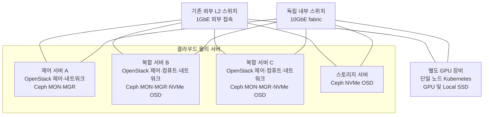

# 하드웨어 구조도

[README](../README.md#구조도와-상세-문서) · [클라우드 소개](../docs/cloud-platform.md) · [관련 검증](../docs/validation.md#확인한-구축과-실행-결과)

2026-09-07 구성 정리본을 바탕으로 한 도식입니다. 역할 기반 별칭이며 물리 포트 번호와 실제 주소를 생략했습니다. 선은 연결 관계로, 화살표 방향의 통신 제한이나 서버별 처리 속도를 뜻하지 않습니다. 내부 스위치의 10GbE 표기를 GPU 장비 NIC 속도로 일반화하지 않습니다.

- 서버별 CPU·RAM·NIC·SSD 보유 현황을 고려해 역할을 배분했습니다.
- 제어 서버 A의 추가 compute 역할은 설계 제안으로 구분하며 이 도식의 구축 범위에 포함하지 않았습니다.
- Ceph MON/MGR와 OSD의 위치가 다르며, NVMe OSD는 복합 서버 B·C와 스토리지 서버에 분산됩니다.
- HDD 클러스터나 미편입 후보 서버는 이 도식에 포함하지 않았습니다.
- 서버별 VLAN 멤버십은 같지 않습니다. Octavia 관리 VLAN은 [네트워크 구조도](04-network.md)에서 별도로 표시합니다.

## 2026-10-16 기준 compute 역할 보완

위 그림과 제안 문구는 2026-09-07 구성 정리본의 당시 범위를 유지합니다. 이후 제어 서버 A에 제한된 compute 역할을 추가했고, 2026-10-11 기록에서 제어 서버 A·복합 서버 B·복합 서버 C에 etcd VM을 한 대씩 배치해 세 VM 모두 Nova ACTIVE임을 확인했습니다. PostgreSQL 두 VM의 복합 서버 B·C 배치는 2026-10-14에 확인했습니다. 추가 물리 서버 확보를 가정한 설계가 아닙니다.

| 공개용 서버 별칭 | 후속 역할과 DB 그림의 대응 |
|---|---|
| 제어 서버 A | 기존 제어·네트워크·Ceph MON/MGR 역할과 제한된 compute, etcd A 배치 |
| 복합 서버 B | 기존 제어·compute·네트워크·스토리지 역할, etcd B 및 PostgreSQL DB VM A 배치 |
| 복합 서버 C | 기존 제어·compute·네트워크·스토리지 역할, etcd C 및 PostgreSQL DB VM B 배치 |

실제 호스트명·주소는 공개하지 않습니다. 배치 확인일과 설계 정리일을 구분하며, VM 분산 배치 확인을 장애 전환·복구·장기 가용성 검증으로 확대하지 않습니다. [검증 문서의 후속 기록](../docs/validation.md#2026-10-16-기준-설계-상태-보완)과 [새 DB 구성도](../docs/ai-chatbot-architecture.md#4-db-접속과-자동-장애-전환)에서 같은 별칭을 사용합니다.
