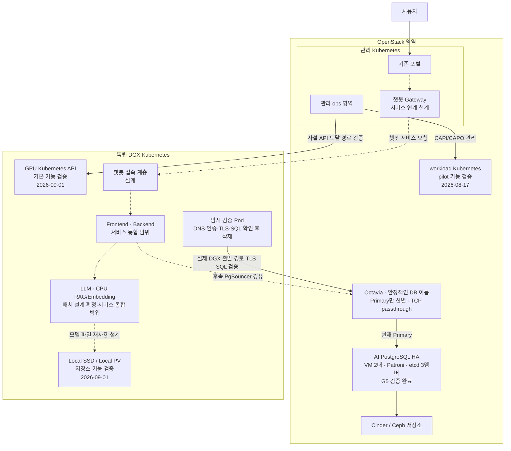

# OpenStack–Kubernetes–GPU 연계 구조도

[README](../README.md#구조도와-상세-문서) · [AI 챗봇 소개](../docs/ai-chatbot.md)

2026-09-07 기반 구성에 2026-10-21 G5 데이터 기반 완료를 반영한 도식입니다. 2026-10-16에 정리한 [AI 챗봇 전체 구조와 처리 흐름](../docs/ai-chatbot-architecture.md)에서 후속 확정 설계와 미결정 사항을 일곱 그림으로 볼 수 있습니다. GPU Kubernetes는 물리 장비 위의 독립 클러스터입니다. Nova compute, CAPO Machine 또는 기존 관리 Kubernetes worker가 아닙니다.

- 실선은 기록에서 확인한 구성·기능 검증 관계입니다. API 경로 검증을 관리 시스템의 등록·배포·모니터링 전체 통합이나 현재 운영 상태로 확대하지 않습니다.
- 점선은 서비스 연계 설계·통합 범위입니다. DGX 검증 Pod의 DB 연결은 완료했으나 Gateway·모델·실제 앱의 전체 E2E는 미확인이며, 시점과 확인 범위는 [검증 기록](../docs/validation.md)에 정리했습니다.
- 본인은 전체 서비스와 인프라 연계 구조를, 협업 구성원 1명은 LLM 관련 설계를 담당합니다.
- Local SSD는 모델 재사용 시 반복적인 원격 전송을 줄이려는 선택이며 DB 통신까지 제거하지 않습니다.
- 단일 GPU 노드 장애에 대한 고가용성을 주장하지 않습니다.

[G5 사례 문서](../docs/g5-postgresql-ha.md)에서 장애별 결과와 데이터 경로·TLS·출발 주소의 경계를 확인할 수 있습니다. 위 검증 Pod는 시험 후 삭제했고 애플리케이션 배포를 의미하지 않습니다.
