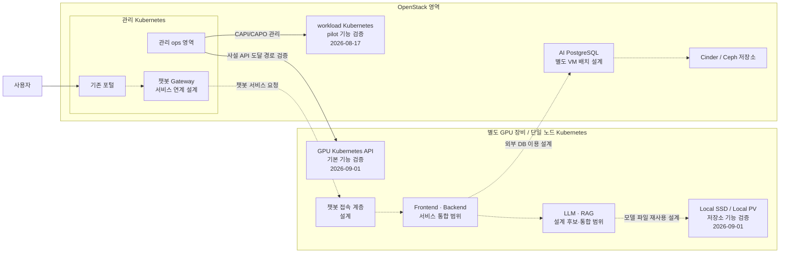

# OpenStack–Kubernetes–GPU 연계 구조도

2026-09-07 구성 정리본을 바탕으로 한 도식입니다. GPU Kubernetes는 물리 장비 위의 독립 클러스터입니다. Nova compute, CAPO Machine 또는 기존 관리 Kubernetes worker가 아닙니다.

- 실선은 기록에서 확인한 구성·기능 검증 관계입니다. API 경로 검증을 관리 시스템의 등록·배포·모니터링 전체 통합이나 현재 운영 상태로 확대하지 않습니다.
- 점선은 서비스 연계 설계·통합 범위입니다. Gateway·모델·앱·외부 DB의 전체 E2E 결과는 미확인이며, 시점과 확인 범위는 [검증 기록](../docs/validation.md)에 정리했습니다.
- 본인은 전체 서비스와 인프라 연계 구조를, 협업 구성원 1명은 LLM 관련 설계를 담당합니다.
- Local SSD는 모델 재사용 시 반복적인 원격 전송을 줄이려는 선택이며 DB 통신까지 제거하지 않습니다.
- 단일 GPU 노드 장애에 대한 고가용성을 주장하지 않습니다.
