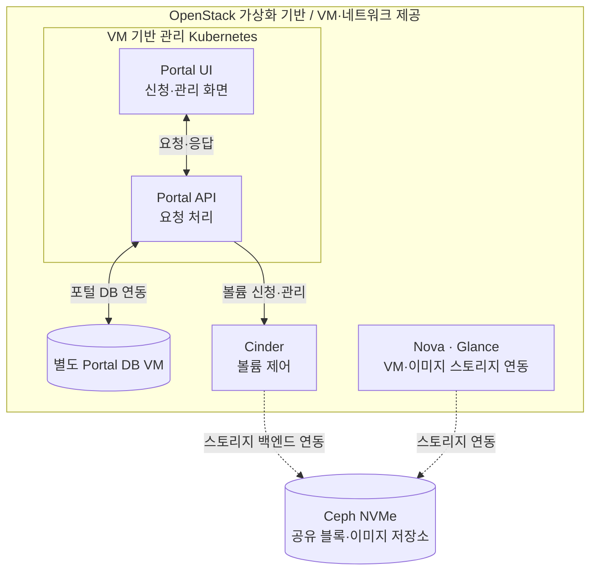
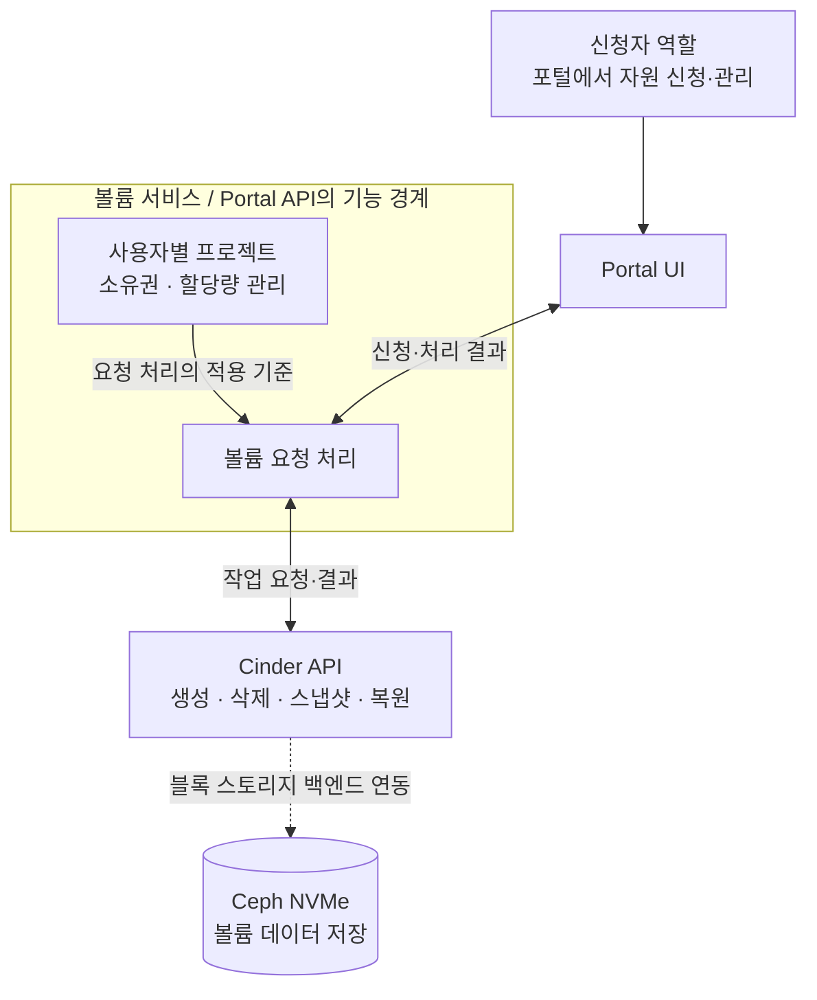

# 사설 클라우드와 볼륨 포털 구조

[README](../README.md#구조도와-상세-문서) · [클라우드 소개](../docs/cloud-platform.md) · [날짜별 검증](../docs/validation.md)

## 목적과 설계 판단

보유 서버를 OpenStack·Ceph 기반으로 통합하고 사용자가 인프라 명령 대신 포털에서 자원을 신청·관리하도록 구성했습니다. 본인은 장비·네트워크·스토리지 통합, 설계와 변경 범위 판단, 결과 검증을 담당했습니다. Codex는 API/Worker 구현·점검 도구·분석을 지원했습니다.

아래는 공개된 2026-09-07 구성 설명을 기능별로 다시 그린 **논리 구조**입니다. 현재 배포 상태나 물리 서버별 배치를 새로 확인한 그림은 아닙니다. 기존 [물리 장비](01-hardware.md)·[OpenStack–Kubernetes](02-openstack-kubernetes.md)·[네트워크](04-network.md) 도식은 그대로 보존합니다.

## 1. 포털 실행 위치와 별도 DB

포털 UI/API는 VM 기반 관리 Kubernetes에, Portal DB는 그 클러스터 밖의 별도 VM에 배치한 관계입니다. UI/API 구분은 설명을 위한 기능 분해이며 별도 Pod 수나 배포 단위를 확정하는 표시가 아닙니다. 점선은 서비스 연동으로, 실제 패킷 경로나 데이터가 모든 API를 통과하는 순서를 나타내지 않습니다.

## 2. 사용자별 볼륨 신청과 처리

볼륨 서비스는 기능 경계입니다. API·비동기 작업의 세부 호출 순서를 확정한 그림이나 Kubernetes 클러스터 생성 worker를 나타내지 않습니다. 사용자별 프로젝트·소유권 범위·할당량은 요청 처리 기준이며, Cinder의 제어 기능과 Ceph의 데이터 저장 역할을 구분했습니다.

## 구축·검증 범위

| 구분 | 확인한 범위 | 확대하지 않는 범위 |
|---|---|---|
| 기반 구축 | 2026년 5월 시작, 7월 31일까지 OpenStack·Ceph와 볼륨 신청·제공 기반 구축 | 전체 구축 과정의 자동화 |
| 기능 구현 | 사용자별 프로젝트·할당량, 볼륨 생성·삭제·스냅샷·복원 | 모든 기능의 세부 프로세스/호출 순서 |
| 기능 확인 | 테스트·관리자 계정으로 신청·처리 결과 확인. 정확한 기능 검증 일자는 기존 공개 기록에 미기재 | 실제 사용자 도입·현재 운영·장기 안정성 |
| 후속 Kubernetes | 8월부터 별도 클러스터 제공 단계로 확장. 날짜별 프로필·사용자 시험은 검증 문서 참조 | 볼륨 포털 시험을 Kubernetes 전체 E2E로 간주 |

[클라우드의 사용자별 볼륨 기능](../docs/cloud-platform.md#사용자별-볼륨-신청과-관리) · [Codex를 활용한 개발과 검증](../docs/cloud-platform.md#codex-development-validation) · [검증 결과](../docs/validation.md)

이 문서는 공개 설명을 보강한 것이며 운영 서버 접속·변경이나 프로젝트 시험 재실행을 수행한 결과가 아닙니다.
