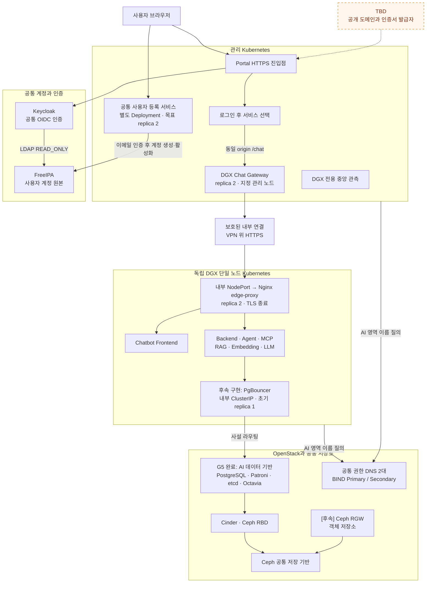
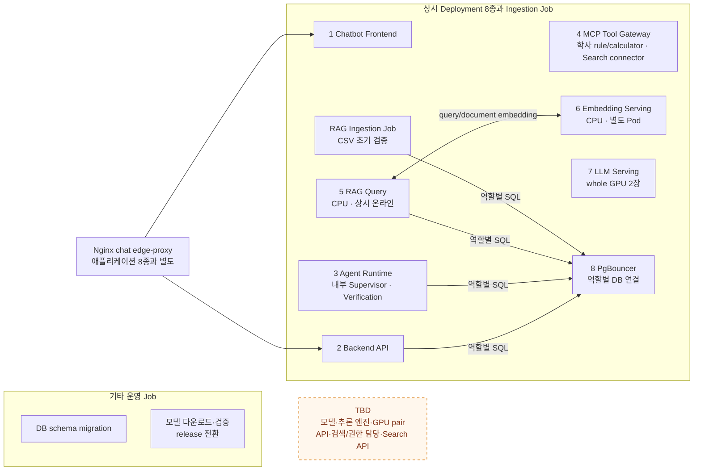
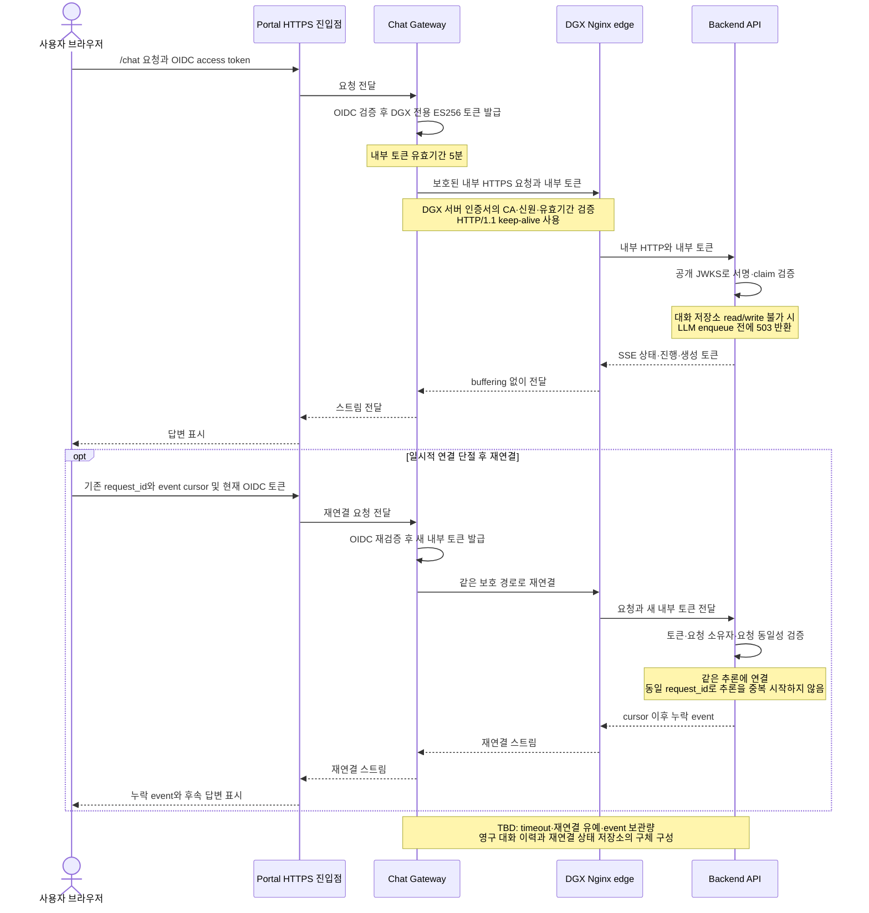
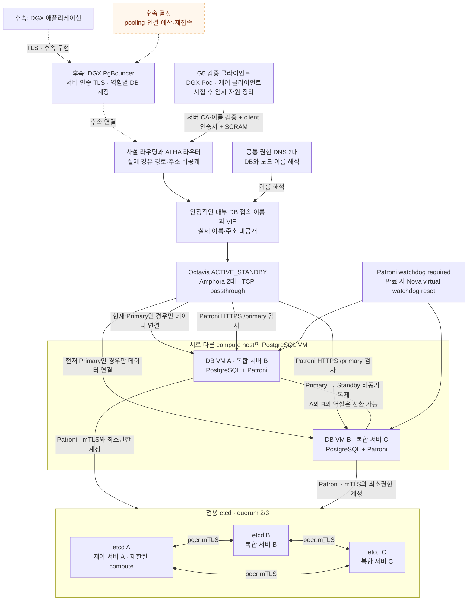
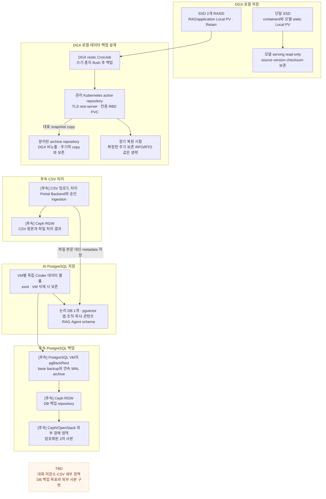
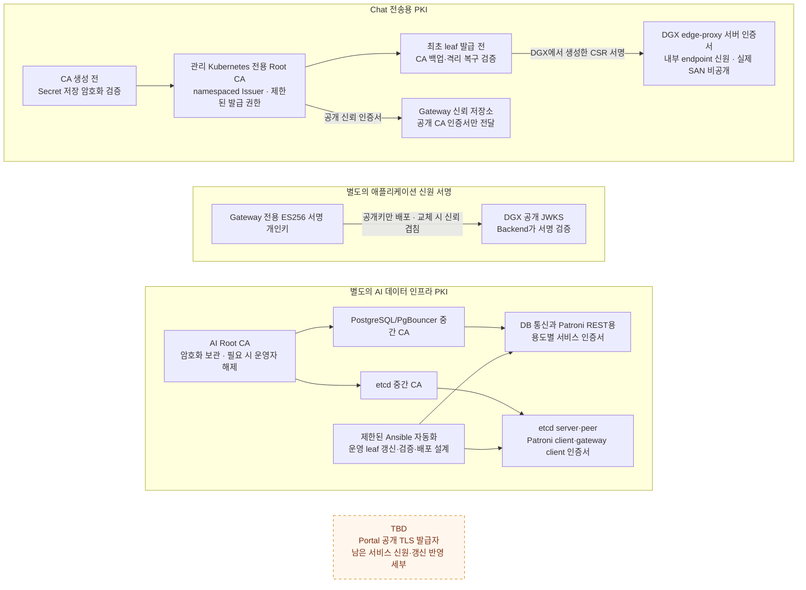
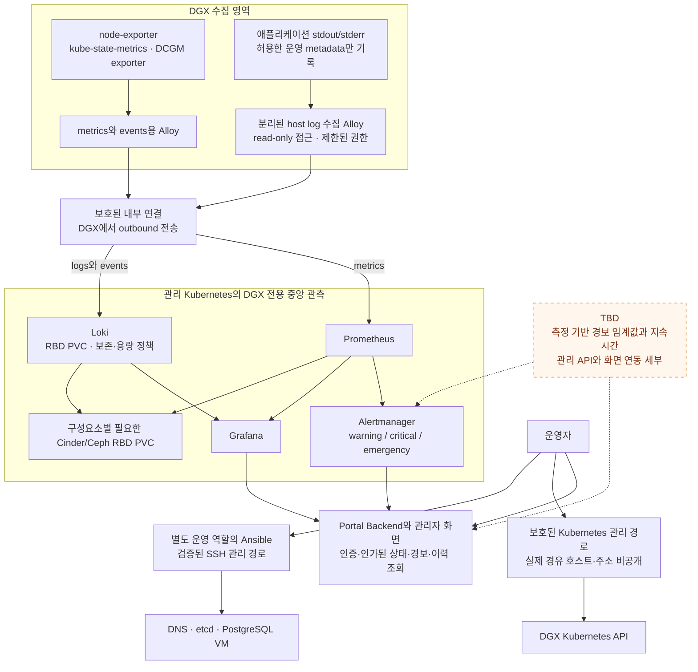

# AI 챗봇 전체 구조와 처리 흐름

[README](../README.md#구조도와-상세-문서) · [AI 챗봇 소개](ai-chatbot.md)

학사 정보를 제공하는 AI 챗봇은 기존 Portal을 사용자 진입점으로 사용하고, 독립 DGX Kubernetes에서 AI 애플리케이션을 실행하도록 설계했습니다. PostgreSQL과 장애 전환 조정용 etcd는 OpenStack에 분리하며, 관리 Kubernetes가 인증 연계와 중앙 관측을 담당합니다.

2026-10-16 확정 설계를 바탕으로 2026-10-21 G5 데이터 기반 완료 상태를 반영했습니다. 일곱 그림 중 서비스·모델·관측·백업 부분은 설계이며, DB 기반의 실제 구축과 시험 범위는 4절에 명시합니다. **설계 관계와 구축·종단 검증 완료는 구분합니다.** 기반 구축과 실제 시험의 날짜별 범위는 [검증 결과](validation.md), DNS·etcd의 검증 흐름은 [AI 데이터 기반](ai-data-foundation-flow.md)에서 확인할 수 있습니다.

## 목차

- [결정 상태와 구현 순서](#결정-상태와-구현-순서)
- [1 전체 배치와 서비스 진입](#1-전체-배치와-서비스-진입)
- [2 상시 Deployment와 운영 Job 구성](#2-상시-deployment와-운영-job-구성)
- [3 인증과 스트리밍 재연결](#3-인증과-스트리밍-재연결)
- [4 DB 접속과 자동 장애 전환](#4-db-접속과-자동-장애-전환)
- [5 저장과 백업 및 후속 CSV 처리](#5-저장과-백업-및-후속-csv-처리)
- [6 인증서와 서명키의 신뢰 경계](#6-인증서와-서명키의-신뢰-경계)
- [7 관측과 운영 관리](#7-관측과-운영-관리)

| 표기 | 의미 |
|---|---|
| 일반 상자와 실선 | 확정한 구성과 설계 관계. 배포·통신 검증 완료 표시는 아님 |
| `TBD`와 흐름도의 주황색 점선 상자 | 아직 결정하지 않은 사항. 시퀀스 그림의 응답 화살표 점선과 구분 |
| `[후속]` | 설계는 확정했으나 구현을 연기한 사항 |
| 역할명과 `비공개` | 실제 값은 존재하지만 공개 설명에서 생략한 정보. 미결정 사항과 구분 |

실제 주소·내부 도메인·호스트명·운영 계정·자원 식별자·키 보관 위치·관리 경유 경로는 역할명으로 일반화했습니다. 백업 용량·주기와 운영 파라미터도 공개 그림에서는 생략합니다.

## 결정 상태와 구현 순서

| 구분 | 범위 |
|---|---|
| G5 완료 | PostgreSQL·Patroni 두 노드, 전용 etcd 세 멤버, Octavia 역할 선별, DGX 검증 Pod의 DNS·TLS·인증·SQL, 시험 자원 정리 |
| 확정 설계 | 독립 DGX 클러스터, Portal 동일 origin 진입, Gateway·edge-proxy 경계, 애플리케이션 8종, 초기 GPU 2장 사용, CPU RAG·Embedding, 별도 PostgreSQL·etcd·접속 계층, 용도별 PKI·관측 |
| 미결정 | 모델·추론 엔진·정확한 GPU pair, 서비스 API와 검색·권한 검사 담당, 대화 이력·재연결 상태 저장소 세부, 공개 도메인·발급자, 아직 확정하지 않은 성능·경보 수치 |
| 구현 연기 | 대화 1차 구현 이후의 RGW·CSV 업로드·pgBackRest/WAL/PITR 및 외부 백업 사본 |
| 공개 생략 | 실제 주소·도메인·호스트 배치 대응·계정·경로·키 보관 위치와 확정된 운영 수치 |

완료한 데이터 기반 위에 GPU 모델 기반과 대화 기능·Portal 연동을 먼저 구현하고, 연기한 객체 저장소·CSV·백업을 연결한 다음 최종 운영 인수로 진행합니다. 대화 1차 구현과 전체 서비스 인수는 별도 단계입니다.

## 1 전체 배치와 서비스 진입

관리 영역과 GPU 실행 영역을 분리하면서 사용자는 Portal의 같은 origin 아래 `/chat`으로 접근합니다. OIDC(OpenID Connect)는 공통 로그인 인증에 사용합니다.

DGX는 Nova compute나 기존 Kubernetes의 worker로 편입하지 않습니다. Gateway 두 복제본은 같은 관리 노드에, edge-proxy 두 복제본은 같은 DGX에 배치합니다. Pod·프로세스 장애와 순차 교체에는 대응하지만 해당 호스트 장애에 대한 고가용성은 제공하지 않습니다. 등록 서비스는 관리 Kubernetes의 별도 Deployment로 두고 서로 다른 worker에 분산하는 설계입니다.

## 2 상시 Deployment와 운영 Job 구성

상시 애플리케이션은 여덟 종류의 독립 Deployment로 분리하고 초기 replica 1을 기본값으로 둡니다. MCP(Model Context Protocol)는 도구 연결 계층, RAG(Retrieval-Augmented Generation)는 검색한 자료를 활용하는 응답 구성 방식입니다. 이 그림은 상시 Deployment와 운영 Job의 구성도입니다. 실선은 확정한 논리 연결과 Backend·Agent Runtime·RAG Query·Ingestion의 역할별 PgBouncer 접근을 표시하며, 전체 요청 처리 순서나 아직 미결정인 API 호출 계약을 고정하지 않습니다.

LLM은 DB에 직접 접근하지 않고 Embedding에도 초기 DB 자격증명을 제공하지 않습니다. RAG와 Embedding은 CPU로 시작하며 V100 총 네 장 중 LLM 두 장, 초기 미배정 두 장으로 나눕니다. 미배정 GPU의 용도와 서비스별 자원 수치는 측정 후 결정합니다. Backend·Agent·RAG Query·Ingestion의 DB 접근은 역할별로 분리해 PgBouncer를 경유합니다. 일반 ingestion은 온라인 요청을 우선하는 유휴시간 처리로 설계하고, Job과 내부 queue의 세부 연계는 구현 계약에서 확정합니다. 전체 재임베딩·인덱스 재구축은 별도 승인한 maintenance Job 범위입니다.

## 3 인증과 스트리밍 재연결

Gateway는 OIDC access token을 검증한 뒤 DGX 전용 서명 토큰을 발급합니다. 원본 OIDC access/refresh token은 DGX에 전달하지 않습니다. SSE(Server-Sent Events)는 상태·진행 상황·생성 토큰을 연속 전달하는 방식입니다.

연결 시작 시 유효했던 내부 토큰이 스트림 중 만료돼도 해당 스트림은 완료하도록 허용합니다. 새 요청·재연결은 다시 인증합니다. 사용자별 영구 대화 이력과 재연결용 제한된 event 상태는 구분하며, 둘의 저장소 세부는 미결정입니다. 명시적 사용자 취소는 Backend까지 전달합니다.

## 4 DB 접속과 자동 장애 전환

G5에서는 검증 클라이언트가 안정적인 DB 이름과 Octavia를 거쳐 PostgreSQL에 접속했습니다. 일반 애플리케이션은 후속 PgBouncer 구축 후 이를 경유하도록 설계했으며, PgBouncer 장애 시 직접 접속으로 우회하지 않습니다. TLS(Transport Layer Security)는 전송 암호화와 서버 인증, mTLS는 양쪽의 인증서를 확인하는 상호 인증에 사용합니다.

DB VM의 이름과 Primary/Standby 역할은 고정하지 않습니다. TCP 응답만 확인하지 않고 Patroni의 Primary 판별 결과가 정상인 member로 연결하는 설계입니다. 비동기 복제의 데이터 손실 가능성과 공통 Ceph 장애 범위는 남습니다. etcd는 Kubernetes의 기존 etcd와 분리하며, 멤버별 독립 데이터 볼륨을 사용합니다. 서버 별칭은 [하드웨어 그림](../diagrams/01-hardware.md#2026-10-16-기준-compute-역할-보완)의 제어 서버 A·복합 서버 B·복합 서버 C와 같습니다. 기존 하드웨어 그림은 2026-09-07 기준이며, 후속으로 제어 서버 A에 제한된 compute 역할을 추가해 세 호스트에 etcd 멤버를 분산 배치했고 2026-10-11 실제 VM 배치를 확인했습니다. [검증 문서의 후속 기록](validation.md#g5-closeout-20261021)에서 PostgreSQL HA와 실제 DGX 검증 경로의 완료를 확인할 수 있습니다. 애플리케이션과 PgBouncer의 연결은 후속 구현입니다.

10월 21일 최종 관측에서 DB VM B는 Primary, A는 Replica였고 TLS 비동기 복제가 정상입니다. Octavia는 HTTPS `HEAD /primary`의 200 응답으로 쓰기 대상만 선택합니다. Replica의 member `ERROR`와 LB/pool `DEGRADED`는 이 역할 검사에서 나온 집계이며, SQL로 확인한 Replica streaming과 함께 해석합니다. listener와 Primary member는 `ONLINE`이었습니다.

TCP passthrough에서는 PostgreSQL 클라이언트와 DB가 TLS 신원을 검증합니다. 별도 health monitor에는 승인된 CA·서버명 검증 예외가 있어 클라이언트의 strict TLS와 동일한 보장으로 취급하지 않습니다. DGX에서 관측한 실제 출발 주소와 제어 클라이언트의 단일 주소를 LB·보안그룹에서 제한했으며 연결 시간은 기존값을 유지했습니다. [G5 사례](g5-postgresql-ha.md)에 네트워크 주소 변환·장애 시험·정리와 미검증 범위를 설명합니다.

## 5 저장과 백업 및 후속 CSV 처리

모델·RAG 로컬 데이터와 PostgreSQL 데이터의 저장 및 복구 경로를 분리합니다. RPO(Recovery Point Objective)는 허용 데이터 손실 구간, RTO(Recovery Time Objective)는 목표 복구 시간입니다. PITR(Point-in-Time Recovery)은 백업과 WAL로 특정 시점까지 복원하는 방식입니다.

RAID0에는 디스크 장애 내성이 없습니다. 재다운로드 가능한 기본 모델은 재현 정보를 보존하고, 재현할 수 없는 모델은 파일도 백업합니다. DGX 로컬 백업 목표와 PostgreSQL 백업 목표는 별개입니다. Cinder volume snapshot은 PostgreSQL-aware backup을 대체하지 않으며, 같은 Ceph의 RGW 사본만으로 Ceph 전체 장애 대비를 완료한 것으로 보지 않습니다. CSV 업로드는 RGW와 관련 권한이 준비될 때까지 비활성화하는 순서입니다.

## 6 인증서와 서명키의 신뢰 경계

PKI(Public Key Infrastructure)는 인증서로 상대 신원을 확인하는 체계입니다. CA(Certificate Authority)는 인증기관, CSR(Certificate Signing Request)은 인증서 서명 요청서입니다. JWT 검증에 사용하는 공개키 묶음은 JWKS(JSON Web Key Set)로 구분합니다.

Chat 전송용 CA, 내부 토큰 서명키, AI 데이터 인프라 CA, Portal 공개 TLS는 각각 별도 경계입니다. 서비스 개인키는 서비스 측에서 생성하고 CSR만 발급 환경으로 전달합니다. 정상 TLS 통신마다 CA 개인키나 발급 서버에 접근하는 구조는 아닙니다. 발급 원리는 [PKI 키와 인증서 흐름](pki-key-certificate-flow.md)에 설명했습니다.

## 7 관측과 운영 관리

DGX의 exporter와 수집 agent가 정보를 모아 관리 Kubernetes의 전용 관측 스택으로 전송합니다. 기존 Ceph 관측 스택과 분리하고 Portal 관리자 화면에서 상태·경보를 통합하는 설계입니다.

초기 경보 전달은 Portal 관리자 화면으로 정하고 외부 알림 수신자는 후속 확장으로 남깁니다. 프롬프트·답변·RAG 본문·토큰·사용자/세션 식별자는 일반 로그와 Loki에 기록하지 않습니다. 서버 생성 request ID는 요청 추적에 전달하되 Loki label이나 사용자 매핑에 사용하지 않습니다.

## 관련 문서

- [AI 데이터 기반의 설계와 동작](ai-data-foundation-flow.md)
- [PKI 키와 인증서 흐름](pki-key-certificate-flow.md)
- [OpenStack과 Kubernetes 및 GPU 연계 개요](../diagrams/03-openstack-kubernetes-gpu.md)
