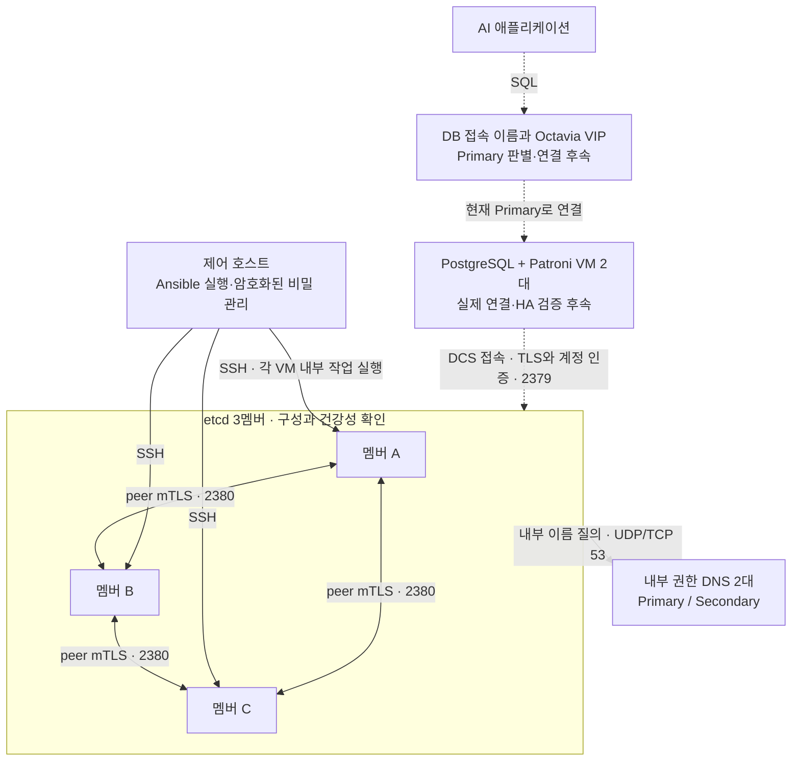
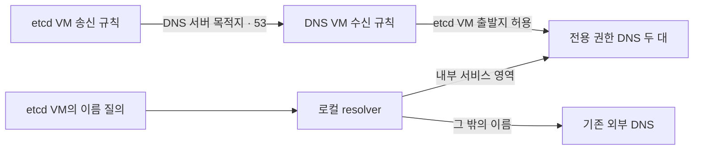
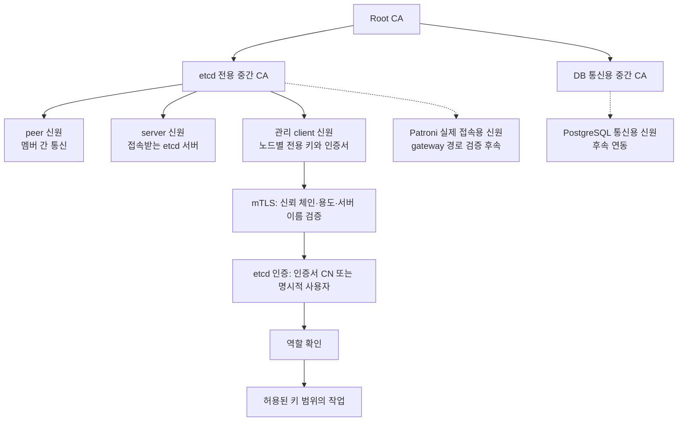
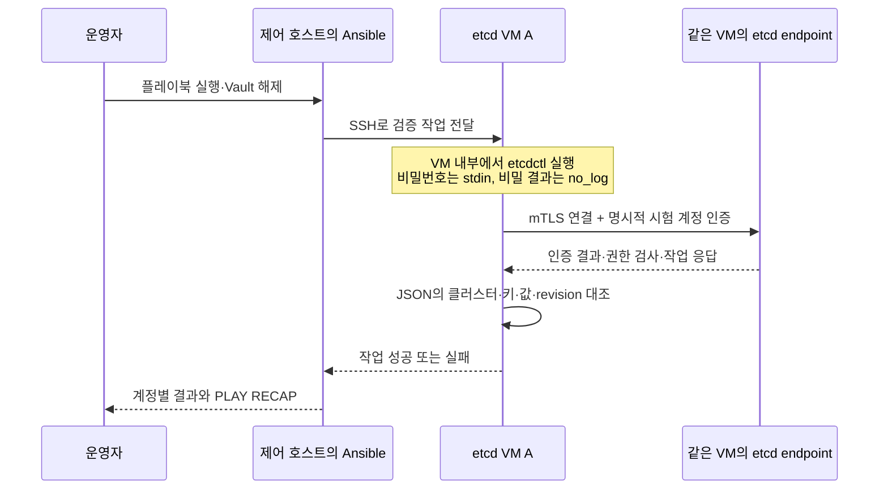
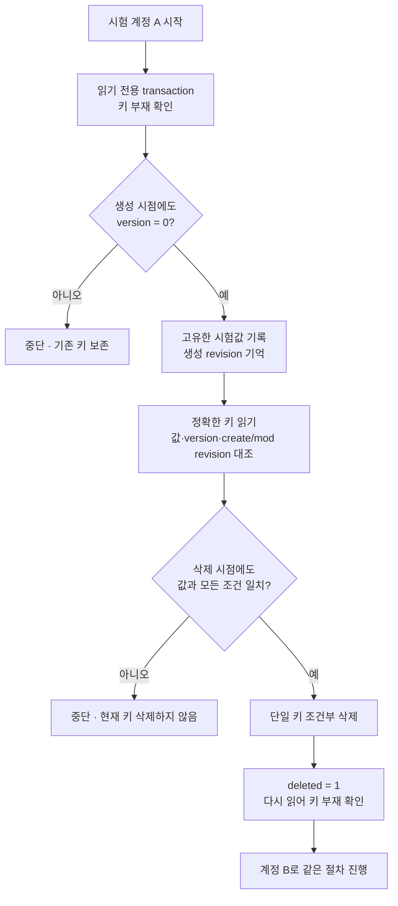

# AI 데이터 기반: DNS·etcd·TLS·권한과 검증 흐름

[README](../README.md#구조도와-상세-문서) · [AI 챗봇 소개](ai-chatbot.md) · [관련 검증](validation.md#ai-데이터-기반의-인증권한-검증)

그림과 1~6절은 2026-10-13 당시의 설계·구성요소 검증 기록을 보존한다. 10월 18~20일 후속 DB 실증과 남은 범위는 7절에 구분했다. 운영 환경의 이름·주소·계정·경로는 공개용 역할명과 예시로 바꿨다. 그림의 실선은 해당 구성 또는 검증된 경로, 점선은 후속 연동 계획을 뜻한다. 모든 장애 상황과 전체 AI 서비스의 성공을 의미하지 않는다.

10월 13일 당시 완료 지점은 **3멤버 etcd의 기동·건강성, 관리 인증, 그리고 두 Patroni용 계정의 제한된 키 접근 검증**이었다. 아래 그림의 후속 표시는 해당 기준일의 범위이며, 이후 DB 연결·복제·장애 시나리오의 확인 결과는 [7절](#db-followup-20261018-20)을 따른다.

## 1. 전체 구조와 역할

etcd는 Patroni가 클러스터 상태와 리더 선출에 필요한 정보를 조정하는 DCS(분산 설정 저장소)로 사용할 기반이다. 애플리케이션의 SQL 데이터는 PostgreSQL에 저장한다. PostgreSQL의 Primary와 etcd의 Raft leader는 서로 다른 역할이며 같은 VM을 뜻하지 않는다.

3개 etcd 멤버는 과반수인 2개로 합의할 수 있는 구조다. 이번에는 동일 클러스터의 3개 투표 멤버, 리더와 상태 일치, 각 endpoint의 건강성 및 알람 부재를 확인했다. 멤버 정지·호스트 장애·재부팅 복구를 실제로 시험한 결과는 아니다.

각 etcd 서비스는 전용 데이터 볼륨을 사용한다. 시작 전에 마운트 위치, 예상 장치, 파일시스템과 데이터 디렉터리 소유권·권한을 검사하는 guard를 실행하도록 구성했다. 잘못된 디스크에서 빈 클러스터가 시작되는 실수를 줄이기 위한 장치이며 백업을 대체하지 않는다.

## 2. 이름 해석과 통신 허용

내부 서비스 영역은 전용 DNS로, 일반 외부 이름은 기존 외부 DNS로 보내는 분기 구성을 적용했다. 내부 멤버 이름 해석과 외부 이름 해석·HTTPS 접근을 검증했다. DNS 서버를 하나 더 추가했다고 전체 인터넷 질의를 그 서버에 맡긴 것은 아니다.

보안그룹에서 etcd 쪽 **egress**는 “etcd VM이 DNS 서버로 보내는 질의”, DNS 쪽 **ingress**는 “DNS 서버가 etcd VM으로부터 받는 질의”다. 이 규칙의 저장과 실제 이름 해석 결과를 구분해 확인했다. DNS 응답 성공이 TLS나 데이터 접근 권한 검증을 대신하지는 않는다.

## 3. 인증서와 계정 권한은 별도 단계

서비스 키는 각 VM에서 생성하고 CSR만 발급 환경으로 가져온 뒤, 서명된 인증서와 체인을 반환했다. 서비스 개인키는 이 과정에서 이동하지 않는다. 일반 통신은 CA 개인키 없이 인증서와 신뢰 저장소로 검증한다. 발급 원리는 [PKI 설명](pki-key-certificate-flow.md)을 참조한다.

etcd 통신에서는 etcd용 중간 CA로 신뢰 범위를 한정했다. 관리용 인증서의 CN과 대응하는 사용자에 관리 역할을 부여했고, 비상 관리 계정은 별도 암호화 비밀 파일에 저장한 비밀번호로 검증했다. 잘못된 비밀번호를 거부하는지도 먼저 확인해 인증서 권한만으로 성공한 결과와 구별했다.

Patroni용으로는 VM별로 독립적인 두 계정과 비밀번호를 준비하고, 공통의 제한 역할을 연결했다. 예시 prefix `/service/example-db/` 아래에서만 읽기·쓰기를 허용하며 관리 역할은 주지 않는다. 두 계정은 같은 DB 클러스터를 조정하므로 해당 prefix는 함께 사용한다. **계정 분리는 자격 증명 분리이며, 두 계정의 데이터 영역 격리를 뜻하지 않는다.** [etcd RBAC](https://etcd.io/docs/v3.6/op-guide/authentication/rbac/)의 사용자·역할·키 범위 모델을 따른다.

HTTP gateway 검사에서는 CN이 있는 관리 인증서로 보낸 요청이 거절됐다. 이후 비상 계정 검사는 etcdctl의 gRPC 경로로 바꿔 성공했다. 따라서 이 성공을 Patroni gateway 접속 성공으로 계산하지 않는다. Patroni의 etcd3 경로는 gRPC gateway를 사용하므로 실제 접속용 TLS 신원과 계정 설정을 따로 검증해야 한다. [Patroni 설정 문서](https://patroni.readthedocs.io/en/latest/yaml_configuration.html)

## 4. Ansible로 실제 확인한 요청 흐름

Ansible은 VM 안에서 실행한 결과를 모으고, assertion으로 기대한 조건과 대조한다. 화면의 `ok`와 `changed` 개수는 작업 결과 집계다. 처리량·지연·장기 안정성을 측정하는 모니터링 통계는 아니다.

이번 Patroni 계정 시험은 etcd VM A 내부에서 자기 endpoint로 수행했다. TLS 연결에는 기존 관리 인증서를 사용했지만 etcd 사용자와 비밀번호는 시험할 계정으로 명시했다. 틀린 비밀번호 거부, 허용 prefix 읽기 성공, 범위 밖 읽기 및 관리 목록 거부를 두 계정 모두에서 확인했다. 실제 DB VM의 네트워크·TLS 경로 검증과는 구분한다.

## 5. 데이터를 남기지 않는 조건부 쓰기·삭제

공개 예시 키는 `/service/example-db/_probe/a`와 `/service/example-db/_probe/b`다. 실제 검증에서도 사전에 정한 시험 키 두 개만 사용했으며 서비스의 리더·설정 키는 건드리지 않았다.

사전 조회와 실제 쓰기 사이에 다른 작업이 키를 만들 수 있으므로 생성 transaction에서 조건을 다시 검사했다. 삭제도 값만 비교하지 않고 version, 생성 revision, 수정 revision까지 검사했다. 누군가 키를 바꿨다가 같은 값으로 돌려놓거나 삭제 후 재생성해도 처음 기록한 revision과 달라지므로 그 키를 지우지 않는다.

비교와 성공 분기의 변경은 하나의 etcd transaction으로 처리한다. 조건이 맞지 않을 때는 아무것도 바꾸지 않고 중단한다. 이 방식은 단순히 마지막에 같은 이름의 키를 삭제하는 방식에서 발생할 수 있는 경합을 피한다. [etcd transaction API](https://etcd.io/docs/v3.6/learning/api/)

2026-10-13 실행에서는 두 계정 모두 조건부 생성, 값·revision 검증, 조건부 삭제, 삭제 후 부재 확인을 통과했다. Ansible 집계는 **ok 33, changed 4, failed 0**이었다. changed 4는 두 키를 각각 한 번 만들고 한 번 삭제한 작업이다. 각 최종 조회 시점에 시험 키가 없음을 확인했으며 추가 정리는 필요하지 않았다.

## 6. 2026-10-13 기준 완료 범위와 다음 경계

| 항목 | 확인한 범위 | 아직 확인하지 않은 범위 |
|---|---|---|
| DNS | 내부 멤버 이름 해석, 외부 이름·HTTPS 접근 | 모든 소비자 및 DNS 장애 전환 |
| etcd | 3멤버 기동·자동 시작 설정, TLS status·health, 멤버·알람 확인 | 멤버/호스트 장애, 재부팅 복구, 성능·장기 부하 |
| 관리 인증 | 인증 활성화, 관리 인증서, 비상 비밀번호의 정상·오류 경로 | 모든 신원·접속 경로의 부정 시험 |
| Patroni 계정 | 서로 다른 비밀번호, 제한 역할, prefix 읽기·쓰기·삭제, 범위 밖 읽기·관리 거부 | 범위 밖 쓰기 거부 시험, 실제 DB VM/gateway 연결 |
| PostgreSQL·Patroni | 두 VM과 DCS를 이용하는 서비스 설계 | 실제 DB 연동, 복제, 승격·재합류 |
| DB 접속 계층 | Octavia의 Primary 판별·접속 설계 | 실제 VIP 경로와 장애 전환 |
| 운영 인수 | 단계별 검증과 비밀 보호 절차 | 인증서 갱신 자동화, 백업·복원 및 전체 서비스 인수 |

## 7. 2026-10-18~20 후속 DB 실증과 남은 범위

| 날짜·시나리오 | 저장된 실행 기록에서 확인한 범위 | 구분할 한계 |
|---|---|---|
| 10월 18일 합성 벡터 | 소량 자료의 저장·L2 검색, HNSW 생성·실제 사용, Replica 데이터·인덱스 반영 | 세션 내 순차 스캔 억제 조건. 기본 planner·성능·검색 품질·실제 앱 시험 아님 |
| 10월 19일 계획 전환·정상 재부팅 | 역할·복제·데이터 보존과 동일 DB 접속점의 TLS 읽기·새 쓰기·복제 | 승인한 시나리오와 관측 시점에 한정 |
| 10월 19일 짧은 watchdog reset | 실제 reset·재부팅·접속 복귀 | 다른 노드 자동 승격 기대는 검증 미통과 |
| 10월 20일 Primary 종료 유지 | 다른 노드의 자동 승격, 같은 접속점의 TLS 읽기·새 쓰기, 원래 노드 Replica 재합류·복제 | 앞선 짧은 시험의 실패와 별도 시나리오. 관측 상한을 정확한 장애 시간으로 해석하지 않음 |
| 10월 20일 Primary 강제 재부팅 | 실제 재부팅 뒤 동일 Primary 복구, 접속 실패 구간 후 재접속·새 쓰기·Replica 반영 | 자동 승격의 증거가 아님. 연속 관측을 조기 종료했으며 실패 계층은 미확정 |
| 10월 20일 DGX 일반 Pod | DNS·TCP 3회, 실제 출발 경로 확인·관측 종료·임시 Pod 정리 | 접근 제한과 DB TLS·인증·SQL 검증은 후속 |

앞선 etcd 계정 시험을 실제 Patroni 접속 성공으로 소급하지 않고, 후속 DB 결과도 실제 AI 애플리케이션 연동·전체 장애·장기 안정성·백업 복원·운영 인수로 확대하지 않는다. 상세한 [검증 범위와 잔여](validation.md#database-validation-20261018-20)를 함께 읽는다.

이 문서는 기존 실행 기록을 바탕으로 정리했으며, 문서 갱신을 위한 운영 서버 재조회나 시험 재실행은 하지 않았다. 다음 운영 단계는 별도 작업 범위와 실행 여부를 확정한 뒤 진행할 계획이다.
