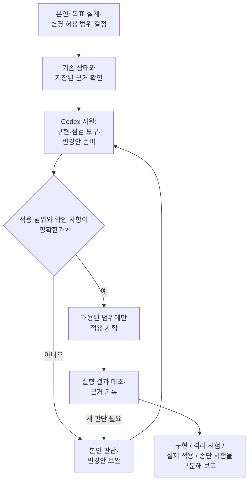

# 클라우드 구축과 사용자 자원 제공

[README](../README.md#구조도와-상세-문서) · [날짜별 검증](validation.md) · [공개 접속 도구](https://github.com/seungyeobchoi/portal-kubectl-access)

OpenStack·Ceph 기반 자원 제공 환경을 구축하고 Kubernetes 제공과 독립 GPU 서비스의 데이터 기반으로 확장했습니다. 장비 역할·네트워크 경로·변경 범위와 성공 조건을 직접 판단했습니다. 아래는 설치 목록보다 제약, 선택 이유와 실행 결과를 중심으로 정리한 대표 사례입니다.

볼륨 포털은 테스트·관리자 계정으로 기능을 확인했으며 실제 사용자 도입 사례는 없습니다. 2026년 5월 시작·7월 31일 1차 구축 이후의 실행 날짜와 실패·후속 기록은 [검증 결과](validation.md)에 보존합니다.

## Octavia 관리망 연결 문제 해결

**문제:** Controller와 Amphora 사이의 관리 L2 경로가 필요했지만 외부 스위치의 제어 권한을 확보할 수 없었습니다. 서버 NIC와 기존 외부망·관리망·VXLAN의 연결 관계를 다시 확인했습니다.

**선택:** 기존 외부망의 Linux bridge·veth·OVS 형태를 참고해 내부망에 Octavia 관리용 VLAN 경로를 추가했습니다. 기존 관리 IP와 관리·VXLAN 통신, 외부망 설정을 유지하는 범위로 변경했습니다.

**결과:** 2026-08-14 시험용 LB의 생성, ACTIVE·ONLINE과 삭제 후 임시 자원 정리를 확인했습니다. 해당 관리 경로와 시험 자원의 검증이며 처리량 향상률이나 모든 장애 복원을 측정한 결과는 아닙니다. [판단 근거](design-decisions.md#기존-구성을-유지한-octavia-관리망-확장) · [기존 네트워크 구조도](../diagrams/04-network.md)

## Kubernetes 제공 서비스로 확장

**문제:** 생성 단계의 성공과 worker Ready만으로 사용자 요청의 완료·정리까지 성공했다고 판단할 수 없었습니다. 2026-09-30에는 생성 성공 뒤 Finalizer 단계에서 실패했고, API 도달성 사전조건의 검사 경로를 분석했습니다. 이 분석만으로 당시 네트워크 장애의 근본 원인을 확정하지는 않았습니다.

**검증:** 수정 후 2026-10-11 새 Standard 1개(control plane 1대·worker 2대)를 신청했습니다. operator 복구·수동 상태 변경 없이 최초 세대의 생성·마무리 작업, 3노드와 API·CNI·CCM·CSI·스토리지 건강, UI ACTIVE와 성공 상태 유지를 확인했습니다. 이어 정상 삭제와 CAPI 하위 자원 부재, 기존 클러스터·원본 볼륨·Cloud 자원 ID·Nova/Neutron 사용량 보존을 대조했습니다.

최종 **31항목은 보존·정합성 검증 범위**이며 성능 향상률이 아닙니다. 기존 볼륨 재연결·읽기·쓰기 거절 시험은 이번 재검증에서 반복하지 않았습니다. 단일 Standard의 당시 버전 결과를 모든 프로필·동시/대규모 요청이나 최신 접속·관측 변경본의 사용자 E2E로 확대하지 않습니다. [정확한 성공·제외 범위](validation.md#standard-e2e-20261011)

10월 19~20일 관측·제어 기능 일부를 실제 적용한 이력도 있습니다. 프로젝트 3개 중 1개는 자격증명 참조 조회 실패였고 당시 활성 workload 관측 대상은 없었습니다. 새 접속·다운로드·역할 UI·사용자 종단은 별도 잔여입니다. [구현과 실제 적용의 구분](validation.md#access-observation-20261018-20)

## PostgreSQL HA와 watchdog 장애 검증

독립 GPU Kubernetes에서 사용할 DB를 OpenStack의 별도 VM에 두고, 리더 조정(Patroni·etcd), 접속 대상 선택(Octavia), watchdog의 책임을 분리했습니다. 재부팅 뒤 장치가 사라지는 문제는 커널 추가 모듈과 부팅 준비 의존 관계로 나누어 보정했습니다.

짧은 watchdog reset에서는 다른 노드의 승격을 입증하지 못했고, 별도 종료 유지 시험에서는 자동 승격·Replica 재합류와 같은 DB 접속점의 TLS 읽기·새 쓰기·복제를 확인했습니다. DGX 일반 Pod의 인증·SQL과 임시 자원 정리까지 2026-10-21 기록에 포함됩니다. 비동기 복제의 무손실, 모든 장애, 모델 응답·AI 앱 전체 E2E를 보장하지 않습니다.

**[PostgreSQL HA 구축과 장애 검증 상세 사례](g5-postgresql-ha.md)**에서 장애별 결과, watchdog 보정, 출발 주소·TLS 경계와 정리를 확인할 수 있습니다. 약 40.4초는 요청 수락 후 첫 성공 관측까지의 값이며 보장 RTO나 정확한 중단 시간이 아닙니다.

## 장비 제약을 반영한 구성

CPU·RAM·NIC 속도와 보유 SSD를 조사하고, 제어 서비스·가상머신·분산 스토리지에 필요한 자원을 고려해 서버별 역할을 배분했습니다. 일부 서버가 제어·컴퓨트·스토리지 역할을 함께 수행하는 구성입니다.

Ceph 복제와 VM 스토리지 I/O, 관리 통신이 기존 1GbE 경로에 집중될 가능성을 고려했습니다. 기존 스위치는 외부 접속용으로 유지하고 내부 통신에는 별도 10GbE 스위치를 구성했습니다. 이는 통신 경로를 분리한 설계 결과이며, 처리량 향상률을 측정한 결과는 아닙니다.

Cephadm으로 NVMe 기반 Ceph를 구축하고 Kolla-Ansible로 OpenStack을 배포했습니다. Nova·Cinder·Glance를 Ceph와 연동해 가상머신 실행 환경과 공유 블록·이미지 저장소를 연결했습니다.

[하드웨어 구조도](../diagrams/01-hardware.md)에 서버별 역할과 물리 연결을 정리했습니다.

## 사용자별 볼륨 신청과 관리

2026년 7월 31일까지 Kubernetes 기반 포털과 Cinder Volume 신청·제공 기반을 구축했습니다. 이는 첫 번째 구축 단계이며, 8월부터 시작한 Kubernetes 클러스터 제공 기능과 구분합니다.

포털에는 사용자별 OpenStack 프로젝트와 자원 할당량 관리, 볼륨 생성·삭제·스냅샷·복원 기능을 구현했습니다. 테스트 계정으로 신청과 처리 결과를 확인하고 관리자 계정에서도 동작을 점검했습니다. 사용자가 인프라 명령을 직접 다루지 않고 자원을 신청·관리하는 흐름을 기능 단위로 검증했습니다.

2026-08-17 pilot·CSI 기능과 8월 28일 정확히 2 replica worker 구성의 검증은 각각 당시 범위로 [검증 기록](validation.md)에 남겼습니다. [기존 OpenStack·Kubernetes 구조도](../diagrams/02-openstack-kubernetes.md)는 9월 7일 구성 설명이며 10월 11일 시험의 모든 설정을 나타내지는 않습니다.

## 공개 코드와 직접 확인할 자료

공개한 [접속 파일 등록기](https://github.com/seungyeobchoi/portal-kubectl-access)는 Windows PowerShell과 Ubuntu Python 구현입니다. Windows PowerShell 5.1/7 각각 22개, Ubuntu 등록 25개와 메모리 시험 키의 서명·검증·등록 5개 검사를 확인했습니다. 합성·격리 시험이며 실제 사용자 kubectl 종단과 WSL 고유 연동은 미완료입니다.

[PowerShell 코드](https://github.com/seungyeobchoi/portal-kubectl-access/blob/main/clients/windows/Register-PortalKubeconfig.ps1) · [Python 코드](https://github.com/seungyeobchoi/portal-kubectl-access/blob/main/clients/ubuntu/register_portal_kubeconfig.py) · [검증·제공 준비 상태](https://github.com/seungyeobchoi/portal-kubectl-access/blob/main/release-status.json) · [클라우드 PDF](../pdf/cloud-portfolio.pdf)

## 본인의 기여

장비 구성과 인프라 통합, 연결 제약 분석, 설계 판단과 변경 허용 범위의 결정, 실행 결과 검증을 담당했습니다. Codex의 API/Worker 구현·점검 도구·로그 분석 지원을 활용하고, 제안된 변경을 허용된 범위에서 적용한 결과와 대조했습니다.

## Codex를 활용한 개발과 검증

기존 상태와 저장된 근거를 먼저 확인하고, Codex가 구현·점검 도구와 변경안 준비를 지원했습니다. 설계·권한·공유 자원 영향처럼 새 판단이 필요한 경우에는 해당 작업을 보류하고 본인 판단 뒤 진행했습니다. 기존 범위 안의 구현과 새 정책 결정을 구분했으며, 결과와 남은 한계를 기록했습니다.

실제로 수행한 범위만 기록하며 앞 단계 성공이 다음 단계 성공을 뜻하지 않습니다. 이 그림은 본인 판단과 Codex 지원의 관계를 설명하며, 모든 작업에서 실제 적용·종단 시험까지 수행했거나 전체 서비스를 자동 배포했다는 뜻이 아닙니다. 날짜별 실행 범위는 [검증 결과](validation.md)를 따릅니다.

[OpenStack과 Kubernetes 구조도](../diagrams/02-openstack-kubernetes.md)에서 관리 클러스터와 시험용 사용자 클러스터의 관계를 볼 수 있습니다.

이번 문서 갱신은 공개 자료와 저장된 기록의 재구성입니다. 운영 서버 접속·새 자원 생성·시험 재실행은 하지 않았습니다.
