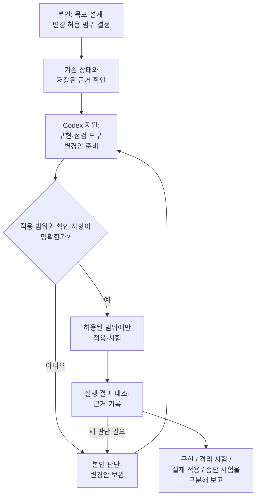

# 클라우드 구축과 사용자 자원 제공

[README](../README.md#구조도와-상세-문서)

보유 서버의 컴퓨팅·스토리지 자원을 통합하고, 사용자가 포털에서 필요한 자원을 신청하는 사설 클라우드를 구축했습니다. 서버별 역할 배분부터 OpenStack·Ceph 연동, 네트워크 확장과 포털 기능 검증까지 담당했습니다.

볼륨 포털은 구축·기능 검증을 완료했습니다. 테스트 계정과 관리자 계정으로 자원 신청·생성·삭제·스냅샷·복원을 확인했으며, 실제 사용자 도입 사례는 없습니다. Kubernetes 클러스터 제공은 기반·worker 검증과 서비스 통합 이력을 구분해 정리했습니다.

## 장비 제약을 반영한 구성

CPU·RAM·NIC 속도와 보유 SSD를 조사하고, 제어 서비스·가상머신·분산 스토리지에 필요한 자원을 고려해 서버별 역할을 배분했습니다. 일부 서버가 제어·컴퓨트·스토리지 역할을 함께 수행하는 구성입니다.

Ceph 복제와 VM 스토리지 I/O, 관리 통신이 기존 1GbE 경로에 집중될 가능성을 고려했습니다. 기존 스위치는 외부 접속용으로 유지하고 내부 통신에는 별도 10GbE 스위치를 구성했습니다. 이는 통신 경로를 분리한 설계 결과이며, 처리량 향상률을 측정한 결과는 아닙니다.

Cephadm으로 NVMe 기반 Ceph를 구축하고 Kolla-Ansible로 OpenStack을 배포했습니다. Nova·Cinder·Glance를 Ceph와 연동해 가상머신 실행 환경과 공유 블록·이미지 저장소를 연결했습니다.

[하드웨어 구조도](../diagrams/01-hardware.md)에 서버별 역할과 물리 연결을 정리했습니다.

## 사용자별 볼륨 신청과 관리

2026년 7월 31일까지 Kubernetes 기반 포털과 Cinder Volume 신청·제공 기반을 구축했습니다. 이는 첫 번째 구축 단계이며, 8월부터 시작한 Kubernetes 클러스터 제공 기능과 구분합니다.

포털에는 사용자별 OpenStack 프로젝트와 자원 할당량 관리, 볼륨 생성·삭제·스냅샷·복원 기능을 구현했습니다. 테스트 계정으로 신청과 처리 결과를 확인하고 관리자 계정에서도 동작을 점검했습니다. 사용자가 인프라 명령을 직접 다루지 않고 자원을 신청·관리하는 흐름을 기능 단위로 검증했습니다.

## Octavia 관리망 연결 문제 해결

로드밸런서 기능을 추가하려면 Controller와 Amphora 사이의 관리망 연결이 필요했습니다. 외부 스위치를 활용하려 했지만 관리자 권한을 확보할 수 없어, 서버 NIC·스위치 포트·기존 관리망과 VXLAN 경로를 다시 분석했습니다.

기존 외부망의 연결 구조를 참고해 내부망에 Octavia 관리용 VLAN 경로를 추가했습니다. 기존 관리망과 VXLAN 설정을 유지한 상태에서 시험용 로드밸런서 생성, ACTIVE·ONLINE 상태와 삭제 후 임시 자원 정리를 확인했습니다. 구체적인 연결 방식과 선택 이유는 [설계 판단](design-decisions.md)에 정리했습니다.

## Kubernetes 제공 서비스로 확장

2026년 8월부터 포털에서 Kubernetes 클러스터를 제공하는 후속 단계의 구성과 통합 작업을 수행했습니다. Project·Quota, 클러스터 이미지, 테넌트 네트워크와 Security Group, 관리 영역과 워크로드 API 사이의 경로를 구성하고 CAPI/CAPO를 연동했습니다.

8월 17일 시험용 클러스터의 control plane 1대와 worker 1대가 Ready인 상태를 확인하고, Cinder CSI를 통한 볼륨 생성·사용·삭제를 검증했습니다. 8월 26일에는 클러스터 생성·정리를 담당하는 Provisioner·Finalizer의 단일 replica 실행을 확인했습니다.

이후 상태 조정과 작업 분배, 표준 클러스터 생성 흐름을 통합하는 작업을 진행했습니다. 2026년 8월 28일 실행 기록에서는 Provisioner·Finalizer·FBS·Dispatcher 각각의 replicas·Ready·Available이 모두 2이고 legacy monolith는 0인 구성을 확인했습니다. 모든 replica-two 단계가 종료되었고 최종 검증과 불변성 검증을 통과했습니다.

2026년 9월 30일 통합 검증에서는 생성 단계 성공 후 Finalizer 단계 실패를 확인하고, API 도달성 사전조건의 검사 경로를 분석했습니다. 전체 E2E 성공은 확인되지 않았습니다. 당시 검증의 적용 범위와 원인 분석의 한계는 [검증 기록](validation.md)에 정리했습니다.

2026년 10월 11일에는 수정 뒤 별도 새 Standard 1개를 control plane 1대·worker 2대로 신청해, 복구 개입 없이 최초 세대의 생성·마무리 작업 성공, 3노드와 API·CNI·CCM·CSI·스토리지 건강, UI ACTIVE와 성공 상태 유지를 확인했습니다. 이어 정상 삭제·CAPI 하위 자원 정리와 기존 클러스터·원본 볼륨·Cloud 자원 ID·할당량 보존을 대조했으며 최종 31개 항목이 통과했습니다. 기존 볼륨 재연결·읽기·쓰기 거절 시험은 이 재검증에서 반복하지 않았습니다. [당시 성공 범위와 제외 사항](validation.md#standard-e2e-20261011)을 별도로 기록했습니다.

10월 19일에는 사용량·클러스터 상태 관측 코드를 실제 적용했고, 20일에는 제어 서비스 두 개의 Ready와 DB TLS 연결을 확인했습니다. 관측 프로젝트 3개 중 1개는 자격증명 참조 조회 실패로 확인 불가였고, 당시 활성 workload 관측 대상은 없었습니다. 중계 신원·기동·ACK, 제품 다운로드·실제 역할 UI와 새 사용자 종단 시험은 남아 있습니다. 이 후속 변경본의 검증을 10월 11일의 성공으로 대신하지 않습니다. [구현·격리 시험·실제 적용의 구분](validation.md#access-observation-20261018-20)을 참조하세요.

## 본인의 기여

장비 구성과 인프라 통합, 연결 제약 분석, 설계 판단과 변경 허용 범위의 결정, 실행 결과 검증을 담당했습니다. Codex의 API/Worker 구현·점검 도구·로그 분석 지원을 활용하고, 제안된 변경을 허용된 범위에서 적용한 결과와 대조했습니다.

## Codex를 활용한 개발과 검증

기존 상태와 저장된 근거를 먼저 확인하고, Codex가 구현·점검 도구와 변경안 준비를 지원했습니다. 설계·권한·공유 자원 영향처럼 새 판단이 필요한 경우에는 해당 작업을 보류하고 본인 판단 뒤 진행했습니다. 기존 범위 안의 구현과 새 정책 결정을 구분했으며, 결과와 남은 한계를 기록했습니다.

실제로 수행한 범위만 기록하며 앞 단계 성공이 다음 단계 성공을 뜻하지 않습니다. 이 그림은 본인 판단과 Codex 지원의 관계를 설명하며, 모든 작업에서 실제 적용·종단 시험까지 수행했거나 전체 서비스를 자동 배포했다는 뜻이 아닙니다. 날짜별 실행 범위는 [검증 결과](validation.md)를 따릅니다.

[OpenStack과 Kubernetes 구조도](../diagrams/02-openstack-kubernetes.md)에서 관리 클러스터와 시험용 사용자 클러스터의 관계를 볼 수 있습니다.
