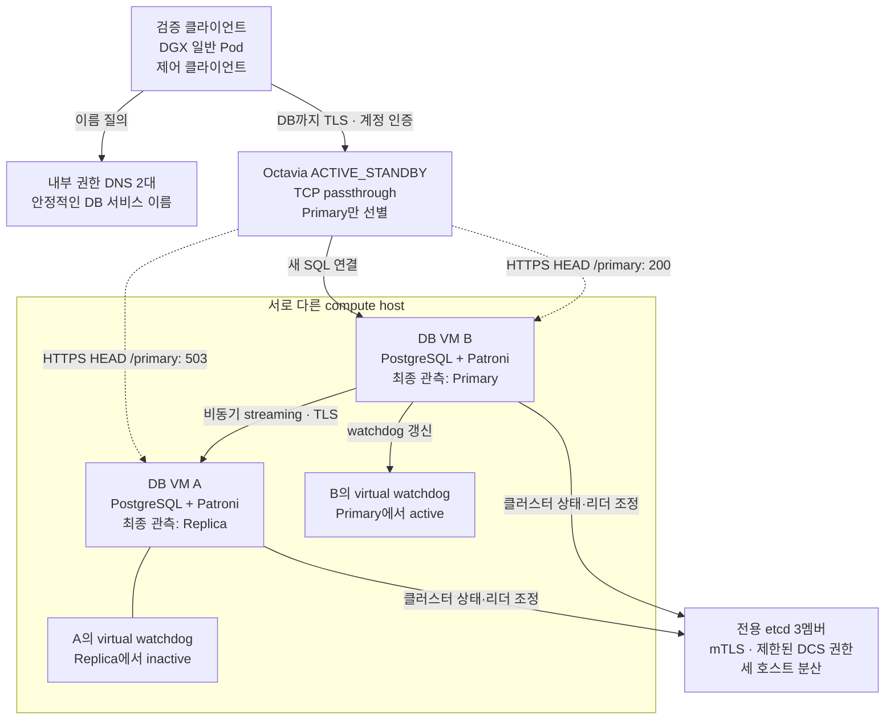
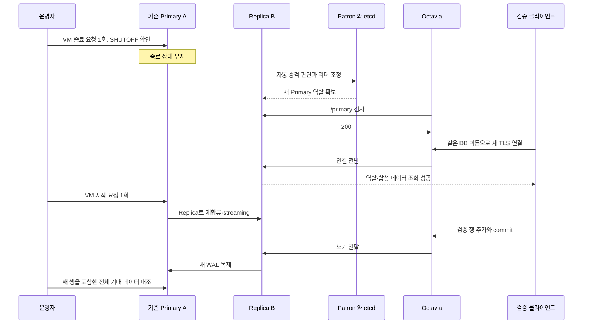
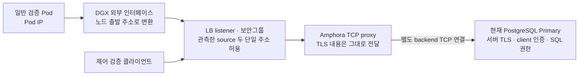

# PostgreSQL HA 구축과 장애 검증 — G5

[README](../README.md) · [AI 챗봇 소개](ai-chatbot.md) · [전체 서비스 설계](ai-chatbot-architecture.md) · [날짜별 검증](validation.md#g5-closeout-20261021)

**독립 GPU Kubernetes에서 사용할 데이터 기반을 구축하고, 장애 후 같은 DB 이름으로 다시 접속해 읽기·쓰기·복제를 확인했습니다.** G5는 이 프로젝트의 데이터 기반 구축·검증 단계입니다. 2026-10-21 KST에 합의한 시험과 임시 자원 정리를 마쳤습니다. 이 문서는 당시 실행 기록의 공개 요약이며 현재 환경을 재조회한 보고는 아닙니다.

| 규모와 구성 | 확인한 범위 |
|---|---|
| PostgreSQL VM 2대 + Patroni, 전용 etcd 3멤버 | 리더 조정, TLS 비동기 복제, 계획 전환·자동 승격·재합류 |
| Octavia ACTIVE_STANDBY, 안정적인 DB 이름 | 현재 Primary 선별과 TCP passthrough, 같은 이름으로 새 연결 |
| PostgreSQL 18.6 · pgvector 0.8.7 | 소량 합성 벡터 저장·거리순 검색·HNSW 생성/사용과 복제 |
| 독립 DGX Kubernetes의 일반 검증 Pod | DNS·출발 경로·TLS·클라이언트 인증·SQL 확인 |
| 시험 종료와 정리 | 합성 9행을 포함한 검증 DB·계정·HBA 규칙 제거, 양쪽 반영과 최종 건강 확인 |

본인은 인프라 구성, 접근 경계, 장애 시나리오와 변경 범위를 결정하고 운영 명령을 실행했습니다. 점검 코드 작성과 로그 분석·문서화에는 Codex의 지원을 받았습니다. AI 서비스의 LLM 설계는 협업 구성원 1명이 담당합니다.

## 해결하려던 문제

GPU 장비의 로컬 저장소와 DB를 함께 두면 GPU 실행 환경의 변경·장애가 데이터 서비스와 직접 결합됩니다. PostgreSQL은 OpenStack의 별도 VM에 두고, DGX에서는 노드 역할이 바뀌어도 같은 서비스 이름으로 연결하도록 구성했습니다. 두 DB VM은 서로 다른 compute host에, etcd 세 멤버도 세 호스트에 분산했습니다.

설치 완료나 프로세스 `active`만으로는 장애 후 동작을 판단할 수 없습니다. 따라서 **리더 역할 → 접속점 선택 → TLS/SQL → 데이터 보존 → 복제 재개**를 각각 확인했습니다. 모델 서빙, 실제 챗봇 요청과 검색 품질은 이 시험에 포함하지 않았습니다.

## 1. 데이터 경로와 제어 경로

아래는 G5에서 구축·시험한 관계입니다. DB VM A/B는 공개용 별칭이며, 그림의 B Primary는 최종 관측 시점의 역할입니다. DNS, LB, etcd는 서로 다른 책임을 맡습니다.

| 구성요소 | 담당하는 일 | 대신하지 않는 일 |
|---|---|---|
| DNS | DB 접속 이름을 유지 | Primary 선출 |
| Patroni + etcd | 리더와 클러스터 상태 조정 | 애플리케이션 연결 풀링 |
| Octavia | `/primary` 응답에 따라 새 연결의 대상 선별 | PostgreSQL 승격, 기존 SQL 연결의 세션 이동 |
| watchdog | Patroni가 장치를 갱신하지 못할 때 VM reset | 모든 장애 조건에서 다른 노드 승격 보장 |
| PostgreSQL 복제 | WAL을 Replica로 전송·재생 | 백업/PITR, 비동기 구성의 무손실 보장 |

애플리케이션용 PgBouncer는 후속 단계입니다. G5의 임시 검증 클라이언트는 LB로 직접 접속했으며, 이 시험이 앱의 풀링·재시도·트랜잭션 재실행 정책까지 검증한 것은 아닙니다.

## 2. 시험마다 다른 성공 조건

각 시험 전 역할·복제·합성 데이터와 서비스 상태를 대조했습니다. 변경 요청은 지정 대상에 한 번만 보내고, 결과가 불명확하면 같은 변경을 반복하지 않도록 실행 표식과 결과를 보존했습니다.

| 시험 | 관측한 결과 | 판단 |
|---|---|---|
| A: 계획 전환·정상 재부팅 | 같은 접속점의 TLS 읽기, 새 쓰기 commit, Replica 반영과 자동 기동 확인 | 승인한 계획 전환·재부팅 범위 통과 |
| B: Patroni 프로세스 SIGSTOP | hypervisor의 실제 watchdog `reset` 사건, boot 변경과 DB 복귀 | watchdog 작동 확인. 같은 노드가 Primary로 복귀해 다른 노드 승격은 입증하지 못함 |
| 별도 Primary 종료 유지 | 기존 Primary를 종료 상태로 유지하는 동안 다른 노드가 자동 승격. 기존 노드 재시작 후 Replica 재합류 | 수동 승격 없이 승격·같은 접속점 TLS 읽기·후속 쓰기/복제를 확인 |
| C: Primary 강제 재부팅 | 실제 boot 변경, 실패 관측 후 같은 Primary로 복구, 데이터/HNSW 보존, 새 쓰기와 Replica 반영 | 해당 재부팅 복구 통과. 다른 노드 자동 승격 결과로 계산하지 않음 |
| D1/D2: DGX 경로·인증 | DNS·TCP·실제 source 확인 후 TLS·인증·9행 조회, 접근 제한 전후 양쪽 클라이언트 성공 | 일반 Pod에서 실제 데이터 경로 확인. 앱 전체 종단은 후속 |

아래 흐름은 **종료 유지 시험**입니다. 앞선 watchdog 시험과 섞지 않고 별도 결과로 기록했습니다.

### 시간 관측을 해석한 방법

C 시험에서는 API 요청 수락 후 첫 성공 관측까지 약 **40.4초**가 걸렸습니다. 요청 수락 뒤에도 성공 표본이 있었고, 이후 실패 표본 4개를 거쳐 다시 성공했습니다. 이 값에는 제어 API 처리와 관측 간격이 포함되므로 정확한 서비스 중단 시간이나 보장 RTO로 사용하지 않습니다.

첫 LB 성공 관측과 양쪽 노드 직접 확인도 구분합니다. 양쪽 역할·복제·데이터/인덱스를 직접 대조한 것은 수락 후 약 188초 이내였으며 시험의 600초 상한 안에 있었습니다. 연속 관측은 사용자가 조기 종료했고 프로세스 종료를 확인한 뒤 쓰기·복제 시험을 진행했습니다. 예정된 관측 시간을 모두 채웠다고 기록하지 않았습니다. 실패 표본만으로 TCP·TLS·SQL 중 어느 계층이 실패했는지도 확정하지 않았습니다.

## 3. 재부팅 시험에서 발견한 watchdog 문제

첫 재부팅 뒤 Patroni는 실행 중이었지만 watchdog 장치가 없었습니다. 두 원인을 나누어 수정했습니다.

| 관측 | 원인 확인 | 보정과 검증 |
|---|---|---|
| 새 커널에서 `modinfo`가 드라이버를 찾지 못함 | 커널 이미지·기본 모듈은 설치됐지만 필요한 추가 모듈 패키지가 빠짐 | generic 커널의 추가 모듈 의존성을 확보하고 드라이버 파일 확인 |
| 수동 로드 후 재부팅하면 장치가 다시 사라짐 | 부팅 로그에서 `i6300esb`의 deny-list 적용 확인 | 해당 드라이버를 준비하는 전용 서비스와 Patroni 시작 의존 관계 구성 |
| 서비스 실행 여부와 장치 소유권·역할이 다른 문제 | watchdog는 Patroni가 사용해야 함 | 장치 신원·접근 권한·timeout·Primary active/Replica inactive 확인 |

서비스 준비 설정만 저장하지 않고 두 DB VM을 실제 재부팅해 장치 자동 준비, Patroni 기동과 복제를 확인했습니다. 이후 SIGSTOP 시험의 libvirt reset 사건으로 장치가 실제 작동하는지도 검증했습니다. 향후 커널 의존성을 확보한 것과 모든 미래 업데이트의 성공을 보장하는 것은 구분합니다.

## 4. DGX 출발 주소와 TLS의 경계

Pod IP만 보고 외부 허용 주소를 정하지 않았습니다. DGX 외부 인터페이스와 LB 측에서 제한된 SYN 헤더를 관측해, 해당 시험 경로에서는 Pod 트래픽이 **DGX 노드의 출발 주소로 변환**되는 것을 확인했습니다.

LB가 보는 출발 주소와 PostgreSQL이 보는 출발 주소는 다릅니다. PostgreSQL 쪽 연결은 Amphora의 backend 연결이므로 DB HBA에 원래 Pod 주소를 넣는 것만으로 이 경로를 제어할 수 없습니다. 외부 접근은 listener·보안그룹에서 제한하고, DB에서는 TLS 신원·DB 계정과 권한을 검증합니다.

두 단일 주소 허용은 노드/호스트 범위의 통제입니다. 같은 노드의 다른 Pod까지 특정 클라이언트로 인증하는 장치가 아니므로 인증서와 계정 권한이 별도로 필요합니다. 이번에는 허용 주소의 성공과 설정 일치를 확인했으며 허용 목록 밖의 실제 접속 거부 시험은 수행하지 않았습니다.

### 일회성 검증 자격 증명 전달

1. digest를 고정한 클라이언트 이미지의 일반 Pod를 사용하고, 비root 계정·메모리 기반 작업 볼륨으로 검증 환경을 준비했습니다.
2. Pod 안에서 TLS 개인키와 별도 전송용 키를 생성했습니다. CSR와 전송 공개키만 발급 환경으로 전달하고 원본 요청 hash를 대조했습니다.
3. 발급 환경에서 CSR에 서명하고, 기존 Vault 검증 비밀번호를 해당 Pod의 전송 공개키로 암호화했습니다. 평문 비밀번호를 호스트 파일이나 출력에 남기지 않았습니다.
4. Pod에서 서버 CA·이름을 확인하고 클라이언트 인증서와 SCRAM 계정 인증으로 연결했습니다. TLSv1.3·DB 역할·정확한 합성 9행을 대조했습니다.
5. listener/보안그룹 접근 제한 후 제어 클라이언트와 DGX Pod에서 같은 검증을 다시 수행하고, 임시 Pod와 전달 암호문을 정리했습니다.

CA 발급 경로와 실제 TLS 연결 경로는 별개입니다. 일반 DB 연결 때 CA 개인키를 가져오지 않습니다. 이 일회성 시험 절차를 운영 앱의 Secret 관리·인증서 자동 갱신 완료로 확대하지 않습니다.

## 5. 상태 화면과 실제 역할을 함께 읽기

최종 Octavia 조회에서 listener와 Primary member는 `ONLINE`, Replica member는 `ERROR`, LB/pool은 `DEGRADED`였습니다. Primary만 통과하는 `HEAD /primary` 검사에서 Replica를 제외한 집계입니다. 별도 SQL 조회에서는 Replica와 TLS streaming이 정상임을 확인했습니다.

따라서 전체 상태 한 줄만 보고 “DB 장애” 또는 “모두 정상”으로 판단하지 않고, **검사 목적·member 역할·DB 복제·실제 접속 결과**를 함께 설명했습니다. health monitor에는 승인한 CA·서버명 검증 예외가 남아 있습니다. 실제 DB 클라이언트의 CA·서버 이름 검증까지 완화한 것은 아닙니다.

## 6. 정리까지 포함한 완료 기준

검증에는 합성 데이터만 사용했습니다. 마감 전 정확한 데이터·테이블/인덱스·종속성·대상 세션을 확인하고, 양쪽 Patroni 설정과 관리 원본에서 전용 HBA 규칙 하나를 제거했습니다. reload 반영을 확인한 뒤 검증 DB와 계정을 Primary에서 삭제하고 양쪽에서 부재를 확인했습니다. 강제 세션 종료나 포괄적인 종속 객체 삭제로 우회하지 않았습니다.

| 제거한 대상 | 유지한 대상 |
|---|---|
| 임시 검증 Pod와 전달 암호문 | 운영 PostgreSQL·etcd·DNS·LB와 볼륨 |
| 합성 9행을 포함한 검증 DB·계정·전용 HBA | 기존 운영 인증 정책·CA·Vault |
| 시험용 DB 내부 테이블·HNSW·확장 객체 | pgvector 패키지, 코드·백업·성공/실패 결과·실행 표식 |

최종 확인은 두 PostgreSQL의 역할·TLS streaming·서비스/watchdog, etcd 세 endpoint의 건강성·리더 일치·알람 없음, Octavia 역할 선별·접근 제한과 기존 timeout 유지였습니다. 검증 DB를 삭제한 뒤 과거 로그인/쓰기 도구를 다시 실행하지 않았습니다.

## 7. 이번 결과로 주장하지 않는 것

- **데이터 무손실 보장:** 비동기 복제이므로 모든 장애 순간의 RPO 0을 입증하지 않습니다.
- **모든 장애의 고가용성:** etcd 멤버 상실·물리 compute 장애·공통 Ceph 장애는 이번 시나리오에 포함하지 않았습니다. 독립 DGX도 단일 물리 노드입니다.
- **모든 복구 경로:** Replica 재합류는 확인했지만 실제 `pg_rewind` 실행은 입증하지 않았습니다. 백업/PITR은 별도 G6 후속입니다.
- **성능·검색 품질:** 작은 합성 자료와 세션 내 순차 스캔 억제 조건의 HNSW 시험이며 기본 planner 선택·ANN 성능·실제 RAG 품질 시험이 아닙니다.
- **전체 AI 서비스 완료:** GPU 모델 canary, PgBouncer·앱 DB 권한·연결 시간 정책, Gateway부터 모델 응답까지의 종단은 후속입니다.

다음 단계는 GPU 실행 환경과 모델 canary를 구체화하는 G7입니다. G5에서는 **설정의 존재, 실제 동작, 장애 시나리오별 증거, 정리 후 상태**를 분리해 기록한 데이터 기반을 확보했습니다.
