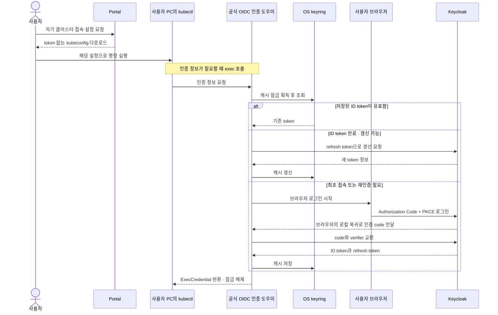
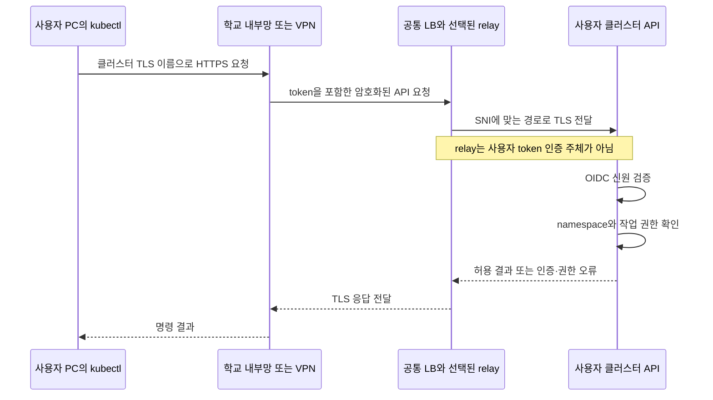
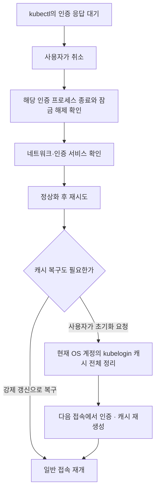

# kubectl 명령의 인증·접속·복구 흐름

기준일: 2026-10-18. Kubernetes 제공 서비스에서 선택한 접속 방식의 공개 설계 설명이다. 내부 주소·계정·자원 식별자를 일반화했다. 그림은 운영 배포 완료를 뜻하지 않는다.

[포트폴리오 홈](../README.md) · [클라우드 프로젝트](cloud-platform.md)

## 1. 최초 준비와 명령 실행

Portal은 소유권과 현재 접속 준비 조건을 확인한 뒤 token 없는 kubeconfig를 제공한다. 설정 파일에는 접속 주소·공개 CA·인증 도우미 실행 방법이 들어간다. 사용자 비밀번호·ID token·refresh token은 넣지 않는다.

유효 캐시를 재사용할 때마다 브라우저를 열지는 않는다. 브라우저 SSO 세션과 keyring 캐시는 별개이며, 재인증 때 화면/동의가 필요한지는 세션 정책에 따른다. 인증 결과는 kubectl이 소비하고 token을 콘솔·로그·설정 파일에 출력하지 않는다.

## 2. 실제 Kubernetes 요청이 지나가는 경로

아래는 공통 접속 gateway를 사용하는 확정 설계 관계다. 전체 사용자 종단 검증과 제품 배포는 남아 있다.

Portal backend는 설정 제공과 준비 상태를 담당하며 kubectl의 일반 API 요청을 대신 중계하지 않는다. LB는 두 relay 중 경로를 선택하며, 요청 하나를 항상 두 relay가 함께 처리하는 구조가 아니다. 두 ACK는 구성 적용 확인이고 실제 네트워크 전송 성공은 별도로 검증한다. API의 공개키 조회는 필요에 따라 수행되므로 매 명령마다 인증 서버에 검증 요청을 보낸다는 뜻도 아니다.

## 3. 응답 지연·캐시 복구와 서비스 상태 표시

공식 도우미를 유지하고 사용자 취소·재시도를 선택했다. 무응답만으로 전체 캐시를 자동 삭제하거나 사용자 명령을 자동 재실행하지 않는다. 초기화 범위에는 같은 OS 계정의 다른 클러스터용 kubelogin 캐시도 포함될 수 있다. 도구·kubeconfig·서버 계정을 삭제하는 절차가 아니며, 실제 취소 전달과 초기화 경합의 제품 검증은 남아 있다.

서비스 상태 UI는 서버 측 준비/경로 관측, 사용자 브라우저 조회 실패, 실제 계획 점검을 구분하는 방향으로 결정했다. VPN이 끊겨 상태를 못 받으면 확인 불가와 마지막 확인 시각을 표시한다. 이를 인증 서버 고장으로 단정하지 않는다. 공개 설정·공개키 조회 성공만으로 실제 로그인·token 갱신 성공을 보증하지 않는다. 상태 UI는 아직 제품 구현·배포 전이다.

## 검증한 범위와 남은 범위

| 구분 | 확인 수준 |
|---|---|
| 공식 도구의 Windows keyring 저장·재사용 | 시험 사용자 경로에서 확인 |
| 실제 ID token 만료 후 갱신·동시 실행 | 시험 환경에서 확인 |
| 손상·저장 실패·응답 보류 등 장애 조건 | 격리 시험으로 관측, 모든 장애의 자동 복구를 뜻하지 않음 |
| 실제 kubectl 취소 전달·전체 초기화 경합 | 추가 검증 필요 |
| Portal의 keyring 설정 제공·gateway 전체 사용자 종단 | 제품 연결·검증 미완료 |
| 최초 지원 OS/계정 범위·설정 파일 최초 신뢰 | 후속 판단 필요 |

공식 참고: [Kubernetes exec 인증](https://kubernetes.io/docs/reference/access-authn-authz/authentication/#client-go-credential-plugins), [int128 kubelogin](https://github.com/int128/kubelogin), [Keycloak OIDC](https://www.keycloak.org/securing-apps/oidc-layers).
