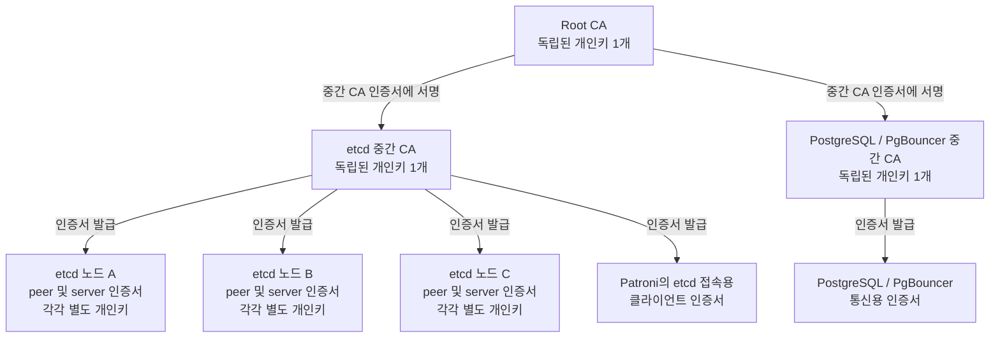
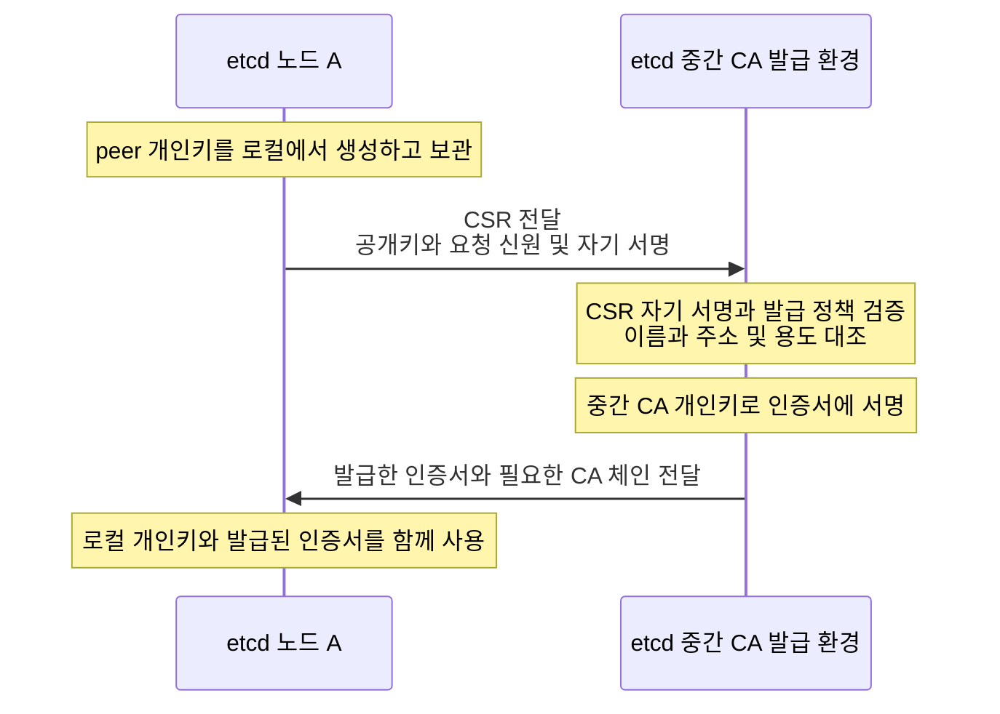
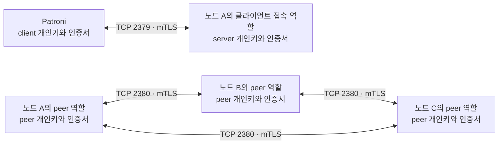

# etcd와 PostgreSQL을 위한 PKI 키와 인증서 흐름

[README](../README.md#구조도와-상세-문서) · [AI 챗봇 소개](ai-chatbot.md) · [관련 검증](validation.md#ai-데이터-기반의-인증권한-검증)

PKI(Public Key Infrastructure, 공개키 기반 구조)는 인증서를 통해 통신 상대의 신원을 검증하는 체계다. 이 문서는 Root CA, 용도별 중간 CA, 서비스 개인키가 어떻게 연결되는지 설명한다. CA(Certificate Authority)는 인증기관을 뜻한다.

아래는 etcd 3노드와 PostgreSQL/PgBouncer를 사용하는 **일반화한 설계 예시**다. 노드 A/B/C는 가상 이름이며 실제 운영 배치나 구축 완료를 나타내지 않는다.

실행 결과와 후속 범위는 [AI 데이터 기반의 설계와 동작](ai-data-foundation-flow.md)에 별도로 정리했다. 이 문서의 가상 예시와 키 수 집계 범위는 그대로 유지한다.

## 개인키 수와 역할

개인키 하나에는 대응하는 공개키가 있다. 인증서는 공개키와 신원 정보, 발급자의 서명을 묶는다. CSR(Certificate Signing Request, 인증서 서명 요청서)은 공개키와 요청 신원 정보를 포함하며 요청자의 개인키로 서명한다. CSR이나 인증서를 만들었다고 개인키가 하나 더 생기는 것은 아니다.

| 소유자                         | 개인키 수 | 역할                                  |
| --------------------------- | ----: | ----------------------------------- |
| Root CA                     |     1 | 중간 CA 인증서에 서명                       |
| etcd용 중간 CA                 |     1 | etcd peer, server 및 접속 클라이언트 인증서 발급 |
| PostgreSQL/PgBouncer용 중간 CA |     1 | 데이터베이스 통신용 인증서 발급                   |
| etcd 노드 A                   |     2 | peer용과 server용 신원 분리                |
| etcd 노드 B                   |     2 | peer용과 server용 신원 분리                |
| etcd 노드 C                   |     2 | peer용과 server용 신원 분리                |

이 표의 범위는 **CA 키 3개 + etcd 노드 키 6개 = 9개**다. 노드별 관리 client, Patroni 클라이언트와 PostgreSQL/PgBouncer의 서비스 키는 별도로 추가된다. SSH 접속 키와 TLS 연결에서 생성되는 임시 세션키는 이 집계에 포함하지 않는다.

이 예시에서는 CA와 etcd 노드 키에 ECDSA P-256을 사용한다. 같은 알고리즘을 사용하더라도 각 개인키는 독립적으로 생성한다.

## 인증서 발급 계층

화살표는 **인증서 발급 관계**다. 상위 CA가 하위 CA나 서비스의 개인키를 생성해 전달한다는 뜻이 아니다.

Root 개인키는 중간 CA 발급과 갱신 등에 사용한다. 일반 서비스 인증서의 발급과 갱신은 해당 중간 CA가 담당하므로 Root 개인키를 매번 사용할 필요가 없다.

중간 CA를 용도별로 나누면 발급 정책과 키 관리를 구분할 수 있다. 실제 접근 격리는 신뢰 CA 설정, 인증서 용도와 신원 검증, 서비스 권한을 함께 구성해야 한다. CA 이름을 나누는 것만으로 접근 격리가 완성되지는 않는다.

## 노드에서 키를 만들고 인증서를 받는 과정

아래는 노드 A의 peer 인증서를 발급하는 예시다. 다른 노드와 server 인증서도 같은 절차를 적용한다. 이 과정은 중간 CA 키와 인증서가 준비된 뒤 진행한다.

CSR 자기 서명 검증은 요청자가 대응하는 개인키를 보유한다는 증거를 확인하는 단계다. 요청한 이름과 주소를 사용할 권한까지 자동으로 증명하지는 않으므로 발급자가 별도 정책과 대조한다. 서비스 개인키는 발급 과정에서 노드 밖으로 전달하지 않는다.

## 실제 통신에서 사용하는 키

etcd의 peer 통신과 클라이언트 접속은 서로 다른 역할이다. 아래 그림은 일반적인 포트와 mTLS(mutual TLS, 상호 TLS 인증) 사용 관계를 나타낸다. 두 노드 A 상자는 같은 노드의 서로 다른 접속 역할이다.

- peer 키와 인증서는 etcd 멤버 사이의 상호 인증에 사용한다.
- server 키와 인증서는 클라이언트에게 etcd 서버의 신원을 증명한다.
- Patroni는 별도의 client 키와 인증서로 etcd에 자신의 신원을 증명한다.

상대에게 보내는 것은 인증서이며 개인키는 보내지 않는다. 상대는 신뢰 체인과 인증서 용도, 유효기간 및 연결 역할에 맞는 신원을 검증하고, TLS 핸드셰이크에서 대응하는 개인키의 보유를 확인한다. 실제 통신 데이터는 협상된 세션키로 보호한다. TLS 인증과 애플리케이션의 데이터 접근 권한은 별도로 관리한다.

일반적인 TLS 핸드셰이크마다 CA 개인키나 발급 서버에 접근할 필요는 없다. 별도로 구성한 인증서 폐기 상태 조회는 다른 문제다.

## Root 개인키의 보관과 사용

Root 개인키를 암호화된 파일로 보관하고 필요한 서명 작업 때만 운영자가 암호를 입력하는 방식을 선택할 수 있다. 암호를 키 파일과 같은 위치에 두지 않고 복호화한 개인키 파일을 남기지 않는 절차로 운영한다.

이 방식은 저장된 파일의 탈취와 무인 사용 위험을 줄이지만, 서명 장비가 침해된 사용 시점의 암호 탈취나 메모리 접근까지 막지는 않는다. 객체 저장소로 암호문을 옮기는 것과, 키를 외부에 내보내지 않는 전용 서명 장치를 사용하는 것은 서로 다른 보호 방식이다.

## 실제 DGX 검증에 적용한 경계

2026-10-20 G5 D2 시험에서는 일반 Pod 안에서 임시 TLS 개인키와 별도의 전송용 키를 생성하고, CSR와 전송 공개키만 발급 환경으로 전달했다. 발급 환경은 요청 hash를 대조한 뒤 인증서를 서명하고 기존 검증 비밀번호를 해당 Pod의 전송 공개키로 암호화했다. 개인키와 복호화한 비밀번호는 Pod의 메모리 기반 작업 볼륨에서 사용했다.

같은 DB 서비스 이름으로 서버 CA·이름을 검증하고 클라이언트 인증서·계정 인증·9행 조회를 확인했다. 시험 후 Pod와 전달 암호문을 정리했으며 기존 CA·Vault는 보존했다. 이 절차는 일회성 검증의 신원 전달이고 운영 애플리케이션의 자동 갱신·Secret 배포 체계 완료를 뜻하지 않는다. [G5 상세 흐름](g5-postgresql-ha.md#dgx-auth)에 신뢰 경계와 한계를 정리했다.

## 참고 문서

- [etcd 통신 보안 모델](https://etcd.io/docs/v3.6/op-guide/security/) — 클라이언트와 peer 통신의 키 및 인증서 설정
- [Smallstep CA 운영 지침](https://smallstep.com/docs/step-ca/certificate-authority-server-production/) — Root와 중간 CA의 역할 및 개인키 보호
- [OpenSSL 인증서 요청 도구](https://docs.openssl.org/3.0/man1/openssl-req/) — CSR 생성과 자기 서명 검증
